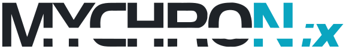
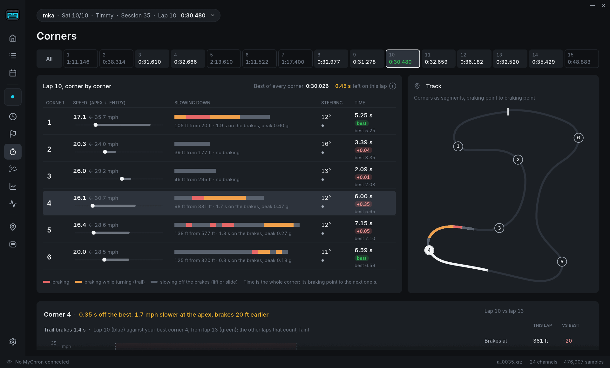
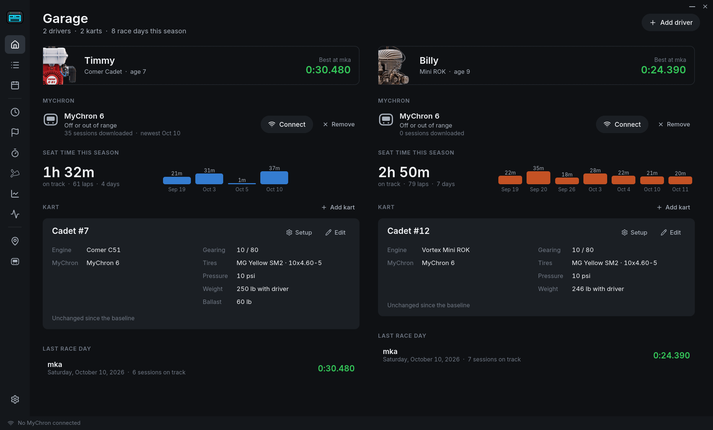
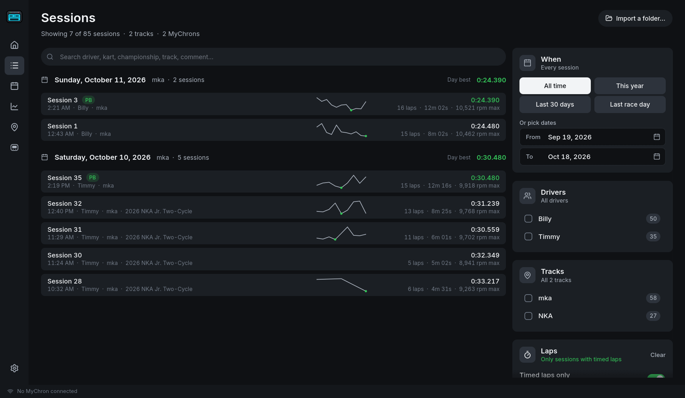
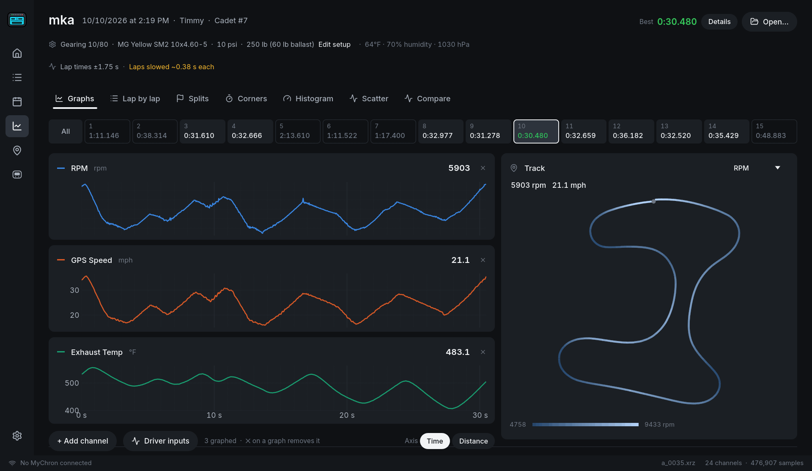
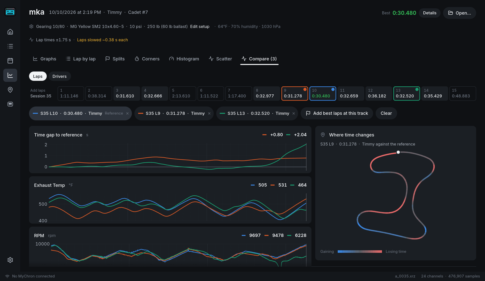
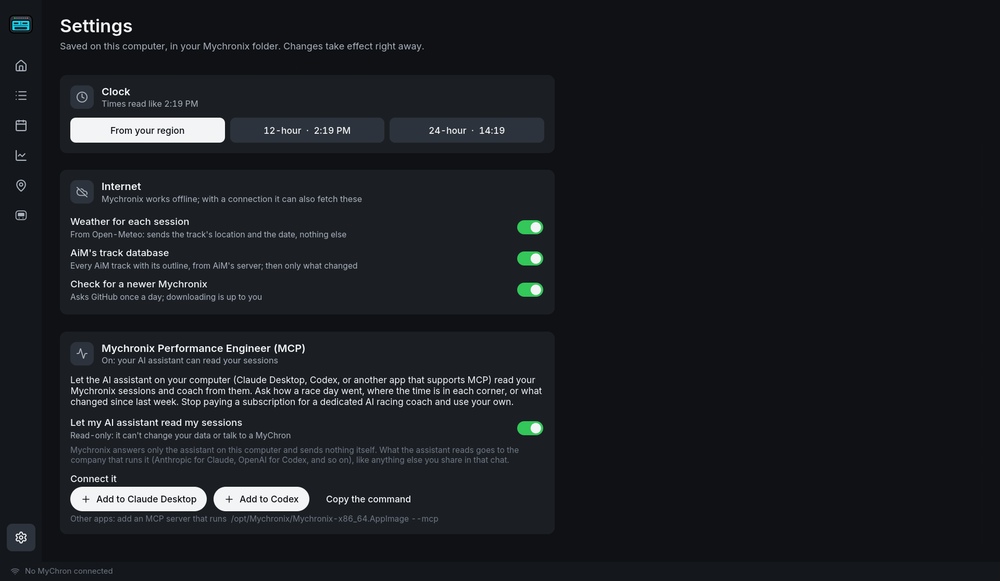

<h1 align="center">
  <picture>
    <source media="(prefers-color-scheme: dark)" srcset="crates/mychronix-gui/assets/mychronix.svg">
    
  </picture>
</h1>

A free desktop app for **AiM MyChron** kart data loggers on **Linux** and
**Apple Silicon Macs**: download your sessions, analyze and compare laps, keep
setup sheets, and follow your season — no Windows and no RaceStudio needed.

AiM's own software, RaceStudio, runs only on Windows. Mychronix is for the kart
racers and families who don't use Windows. If you're on Windows, use RaceStudio.



> Mychronix is an independent project. It is not affiliated with, endorsed by
> or supported by AiM Tech Srl. MyChron and RaceStudio are trademarks of
> AiM Tech Srl.

## Which MyChrons work

| MyChron | How it downloads | Status |
|---|---|---|
| **MyChron 6, 6T** | Over the MyChron's own WiFi | Works; tested on a MyChron 6 |
| **MyChron 5, 5S, 5 2T, 5S 2T** | Over WiFi, the same way | Expected to work; not yet tested on one |
| **MyChron 4, 4 2T, 4 660** | With AiM's USB data key | Works; tested on a MyChron 4 with the key |
| MyChron 4 with an expansion box or CAN devices | Data key | Read the way RaceStudio 2 reads them; not yet tested on hardware |
| MyChron 3 | Serial cable | Not supported yet |

Mychronix only ever **reads** from your MyChron and data key. It never changes
settings, deletes sessions or updates firmware.

## Share your sessions

**We're looking for sample sessions from every kind of MyChron**: the 3, 4, 5
and 6 series and all their variants, and **especially ones with lots of sensors
and expansions connected** (expansion boxes, CAN devices, water and exhaust
temperatures, lambda, steering, brake pressure, wheel speed, extra GPS). Every
logger and accessory records a little differently, and the only way to support
one properly is to read real sessions from it.

To share one, [open an issue](https://github.com/crgklr/mychronix/issues/new)
and attach the files zipped up:

- **MyChron 5 and 6:** the `.xrk` or `.xrz` (and its `.xri` if you have it),
  from RaceStudio 3 or from Mychronix's `~/Mychronix/sessions` folder.
- **MyChron 4:** RaceStudio 2's `.drk` with its `.gpk`, `.rrk` and `.imd`
  beside it, or the `.mc4` files Mychronix saves.
- **MyChron 3:** whatever RaceStudio saved.

Say which MyChron it is and what's plugged into it. A session with a few laps
is plenty. Issues are public, and session files can hold driver and kart names
and the track's GPS position, so share only what you're happy to make public.

## What it does

- **Download** from your MyChron. Add it from the Device page and Mychronix walks
  you through connecting: over WiFi it can join the MyChron's network for you
  (on Linux), and with the data key it finds the key when you plug it in. New
  sessions are offered for download with RaceStudio-style details (driver, kart,
  championship, session type, track, comment). Nothing already downloaded is
  ever overwritten.
- **Import** sessions you already have: choose a folder (from RaceStudio, a USB
  stick or a friend) and Mychronix finds the `.xrk`, `.xrz` and `.drk` files in
  it, skips any already in your library and leaves everything else alone. On a
  Mac you can also drag files or folders onto the window.
- **Garage** (the home page): your drivers, their karts and the MyChron on each,
  seat time and race days. A new MyChron gets a card asking whose it is and which
  kart it goes on. MyChrons can move between karts and drivers (handed down to a
  younger sibling, say) and every session stays with the kart it was recorded on.
- **Sessions**: everything by race day, with best laps and lap-time sparklines.
  Filter by dates (presets or a calendar that marks your race days), drivers,
  tracks and timed laps; search by anything.
- **Analysis**: channels over time or distance on a shared cursor, a track map
  colored by any channel, every lap as a strip across the top.
- **Corners**, the way a data team reads them: each corner from its braking
  point to the next one's (so the exit counts), against the best you've driven
  each corner. One row per corner shows the speed given up, how the kart slowed
  (braking, trail braking, or lifting and sliding), steering and the time lost;
  the best of every corner adds up to the lap you've already proven you can
  drive. The selected corner is drawn up close, headed by what stands out.
- **Lap by lap**, **Splits**, **Histogram** and **Scatter** (RPM against speed
  with your gearing drawn in, the grip circle).
- **MyChron 6 motion sensor**: worked out for however the MyChron is mounted,
  with nothing to set: braking and acceleration (Forward g), bumps (Vertical g),
  grip used around the lap, trail braking, bumps and curbs hit on most laps, and
  steering corrections without a steering sensor when the MyChron is on the wheel.
- **Compare** laps, or each driver's best lap at a track, lined up by distance,
  with the time gap and where time was won and lost.
- **Speed without GPS**: worked out from RPM, gearing and rear tire size (marked
  wherever it's used, since it can't be exact), so a MyChron without GPS still
  gets corners and comparisons.
- **Events**: sessions grouped by week, track and championship, as RaceStudio
  does, plus events you plan ahead; a season summary per championship.
- **Setup sheets**: gearing, tires and pressures, weight and ballast, jetting
  and notes per session (and each kart's clutch engagement in the Garage); each session inherits the last one and changes
  are flagged.
- **Session notes and sensor check**: what stands out across a session's laps,
  and a warning when a sensor that has worked before stops recording.
- **Tracks**: AiM's track database (about 5,600 tracks with outlines, details and
  logos), your custom tracks, maps and satellite views, favorites.
- **Weather** at the track when each session started.
- **AI race coaching with your own assistant**: the Mychronix Performance
  Engineer lets Claude Desktop, Codex or another app that supports MCP read your
  sessions and coach from them. No subscription; see below.
- **Settings**: units, 12- or 24-hour times, and what Mychronix may fetch from
  the internet.
- **Works offline.** At the track with no signal, everything you've downloaded is
  there; anything that needs the internet waits until you're back online.

## Screenshots

| | |
|---|---|
|  |  |
| **Garage**: drivers, karts, MyChrons and seat time | **Sessions** by race day, with filters |
|  |  |
| **Analysis**: channels over a lap, the track colored by RPM | **Compare**: the gap to the best lap and where it grows |
|  | |
| **Settings**, with the Mychronix Performance Engineer | |

## Install

Download the latest release from the
[Releases page](https://github.com/crgklr/mychronix/releases).

### Linux

**Fedora**: add the Mychronix repository once, and `dnf upgrade` (or GNOME
Software) brings each new version:

```sh
sudo curl -fsSL -o /etc/yum.repos.d/mychronix.repo https://crgklr.github.io/mychronix/mychronix.repo
sudo dnf install mychronix
```

**Ubuntu, Debian, Mint, Pop!_OS**: the same, for `apt`:

```sh
sudo install -d /etc/apt/keyrings
curl -fsSL https://crgklr.github.io/mychronix/mychronix.gpg | sudo tee /etc/apt/keyrings/mychronix.gpg > /dev/null
echo "deb [signed-by=/etc/apt/keyrings/mychronix.gpg] https://crgklr.github.io/mychronix/deb ./" | sudo tee /etc/apt/sources.list.d/mychronix.list
sudo apt update && sudo apt install mychronix
```

Or download one from the [latest release](https://github.com/crgklr/mychronix/releases/latest):

| Download | For |
|---|---|
| `Mychronix-<version>-x86_64.AppImage` | Any distribution, no install: make it executable and double-click it. AppImage updaters such as Gear Lever update it from GitHub. |
| `mychronix_<version>-1_amd64.deb` | Ubuntu, Debian, Mint, Pop!_OS: `sudo apt install ./mychronix_*.deb` |
| `mychronix-<version>-1.x86_64.rpm` | Fedora, openSUSE: `sudo dnf install ./mychronix-*.rpm` |
| `mychronix-<version>-x86_64.tar.gz` | Anything else: unpack and run `bin/mychronix-gui`. |

They run on Ubuntu 22.04 and newer, or any distribution from 2022 on (glibc
2.35+: Debian 12, Fedora 36, Mint 21 and later). Joining the MyChron's WiFi
from inside the app uses NetworkManager, which nearly every desktop has; without
it, join the MyChron's network yourself and everything else works.

**MyChron 4 data key:** Linux needs AiM's USB rule to let Mychronix read the
key without root. The `.deb` and `.rpm` install it. With the AppImage or the
tarball, install it once (the tarball includes the file; for the AppImage it's
`packaging/linux/70-mychronix-aim.rules` in this repository):

```sh
sudo cp 70-mychronix-aim.rules /etc/udev/rules.d/ && sudo udevadm control --reload
```

### Mac (Apple Silicon)

For M1 and newer Macs on macOS 11 or later. With [Homebrew](https://brew.sh),
and `brew upgrade` brings each new version:

```sh
brew install --cask crgklr/mychronix/mychronix
```

Or open `Mychronix-<version>-arm64.dmg` from the
[latest release](https://github.com/crgklr/mychronix/releases/latest) and drag
Mychronix into Applications.

Mychronix isn't signed by Apple yet, so the first launch shows "Apple could not
verify…". Click Done, open System Settings → Privacy & Security, and click
**Open Anyway** next to Mychronix (once per version).

On a Mac, join the MyChron's WiFi (named `AiM-MYC…`) from the menu bar yourself:
macOS doesn't let apps list WiFi networks. Mychronix finds the MyChron once
you're on its network. If macOS asks to let Mychronix find devices on your local
network, allow it.

### Updates

Installed from the Fedora or Ubuntu repository or with Homebrew, Mychronix
updates with the rest of your system (`dnf upgrade`, `apt upgrade`, `brew
upgrade`, or your software center). Every way you install it, Mychronix also
checks GitHub once a day for a newer release and, if there is one, shows
what's new. Nothing installs by itself.

## Using it

The first time you open Mychronix, it offers two ways to start:

1. **Connect your MyChron:** pick your model and follow the steps; Mychronix
   shows when it has found it, then **download** the new sessions it offers.
   (Later, the Device page's **Add a MyChron** does the same.)
2. **Or import session files** you already have: choose their folder.

Then:

3. **Set up the Garage:** say whose MyChron it is and which kart it's on, and
   fill in the kart's baseline setup (gearing and tire size matter most without
   GPS).
4. Open any session from **Sessions** or the Garage to analyze it.

### MyChron 4 and the data key

The MyChron 4 has no download cable: AiM's data key carries the sessions.

1. At the kart, with the MyChron **switched off**, plug the data key into it,
   then switch the MyChron on. It shows "Downloading data" for a few seconds
   while it copies the new sessions to the key, then switches off.
2. Unplug the key and plug its USB end into your computer.
3. Mychronix finds the key, lists its runs and offers the new ones.

RaceStudio 2 files (`.drk`, with the `.gpk`/`.rrk` GPS files beside them) open
too: use **Open…**.

### Track learning

At a track AiM's database doesn't have, or whose layout has changed, turn on
**track learning** on the MyChron and set the start/finish line there, or every
session records as one long lap. Tracks learned on a MyChron 5 or 6 are copied
into Mychronix automatically when you connect it.

## Your data

Everything stays on your computer, in `~/Mychronix/`:

| Where | What |
|---|---|
| `sessions/<logger serial>/` | Downloaded sessions, as the MyChron stores them (`.xrz`, or `.drk` for a MyChron 4), with their details (`.meta.json`) and setup sheets (`.setup.json`) beside them |
| `profiles.json` | Drivers, karts and MyChrons |
| `setups.json`, `events.json`, `settings.json` | Kart baselines, events, settings |
| `aim-tracks/` | AiM's track database (downloaded; safe to delete, it comes back) |
| `tracks/` | Custom tracks, and any `.ria`/`.tkk` track files you add yourself |

Removing a MyChron or kart in the Garage only hides it; deleting a driver moves
that driver's sessions to the system Trash, after asking twice. A settings file
that can't be read is kept as `<name>.damaged-<time>.json` rather than
overwritten.

## Internet use

Mychronix works without an internet connection. When there is one, it uses it
for these, and sends nothing about you:

| What | From | Turn off |
|---|---|---|
| AiM's track database: all of it the first time (~70 MB, under a minute), then only what changed | AiM's public track server, the one RaceStudio 3 uses | Settings → Internet |
| Weather when each session started (only the track's position and the date are sent) | [Open-Meteo](https://open-meteo.com) | Settings → Internet |
| Whether a newer Mychronix is out | GitHub | Settings → Internet |
| Map tiles and satellite imagery, cached once viewed | OpenStreetMap; Esri World Imagery | — |

Settings (the gear at the bottom of the sidebar) are saved in
`~/Mychronix/settings.json`. Units and the clock follow your computer's region
until you pick them there.

## AI race coaching: the Mychronix Performance Engineer

Plenty of lap-timing apps sell an "AI coach" by subscription. Mychronix lets
you use the AI assistant you already have instead. Turn on **Settings → Mychronix
Performance Engineer**, then press **Add to Claude Desktop** or **Add to
Codex** (or copy the command into any app that supports MCP servers). Restart
the assistant and ask it things like *"How did Saturday go, and where is the
time in each corner?"*

It's an [MCP](https://modelcontextprotocol.io) server built into Mychronix
(`mychronix-gui --mcp`). It's read-only: it can list sessions, read a session's
laps, setup and weather, go corner by corner, compare two laps, read a channel
through a lap, and follow race days over a season, with the same numbers as the
app's own screens. It can't change your data or talk to a MyChron, and it's off
until you turn it on. Mychronix sends nothing itself; what the assistant reads
goes to the company that runs it (Anthropic for Claude, OpenAI for Codex), like
anything else you share in that chat.

## Troubleshooting

- **Logs:** `~/.cache/mychronix/mychronix.log` on Linux,
  `~/Library/Logs/Mychronix/mychronix.log` on a Mac. Every connection, download
  and on-screen error is recorded there. Start Mychronix with
  `MYCHRONIX_LOG=debug` for more, or `MYCHRONIX_LOG=trace` to record every
  message exchanged with the MyChron. A crash writes `crash.log` beside it.
- **The MyChron isn't found over WiFi:** make sure its WiFi is on in its own
  menu and that this computer has joined its `AiM-MYC…` network; the MyChron
  gives no internet, so the computer may warn about that.
- **The data key isn't found on Linux:** install the USB rule (see Install).
- **A session has no lap times:** track learning was probably off (see above).

## Command line

```sh
mychronix info session.xrz        # a session's laps and channels
mychronix sessions                # downloaded sessions
mychronix device probe            # is a MyChron answering over WiFi?
mychronix device pull             # download every new session over WiFi
```

`-v` / `-vv` print more. On a Mac the tool is inside the app, at
`Mychronix.app/Contents/MacOS/mychronix`.

## Building from source

Needs Rust ([rustup](https://rustup.rs)), a C compiler and ImageMagick (for the
icons).

```sh
./scripts/install-desktop.sh      # build, then install to ~/.local/bin with a launcher
cargo test --workspace            # run the tests
```

`scripts/package-linux.sh` and `scripts/package-macos.sh` build the release
downloads; `.github/workflows/release.yml` runs them for every `v*` tag.

## How it works

AiM doesn't publish how its loggers talk to a computer. The WiFi protocol was
worked out from recordings of RaceStudio 3 talking to a MyChron 6, and the data
key's from RaceStudio 2, for interoperability with hardware we own. Everything
known, where it came from and how sure we are of it is in
[docs/protocol-notes.md](docs/protocol-notes.md).

| Part | What it does |
|---|---|
| `crates/aim-link` | Talking to MyChrons: WiFi discovery and messages, the data key over USB. Read-only by design. |
| `crates/aim-xrk` | Session files: `.xrk`/`.xrz` (via [libxrk](https://github.com/m3rlin45/libxrk)), RaceStudio 2's `.drk` and its GPS files, MyChron 4 runs, sensor scaling |
| `crates/aim-track` | AiM track files (`.ria` lists, `.tkk` tracks) |
| `crates/mychronix-cli` | The `mychronix` command |
| `crates/mychronix-gui` | The app, built with [egui](https://github.com/emilk/egui) and [fastframe](https://github.com/crmne/fastframe) |
| `tools/` | Development aids: regenerating the sensor table from RaceStudio 2, and a bridge for recording RaceStudio 2 with the data key |

## Still to do

Roughly in priority order:

- [ ] Test a MyChron 5 (and a MyChron 4 with an expansion box) on real hardware.
      [Sample sessions](#share-your-sessions) help a lot here.
- [ ] Edit sessions' details after downloading, one or many at once.
- [ ] Export sessions and laps to CSV.
- [ ] Drag and drop on Linux under Wayland (waiting on the windowing library).
- [ ] Make a custom track from a session's lap; import and export `.tkk` files.
- [ ] Device information: firmware version, tracks stored on the MyChron,
      odometers (read-only).
- [ ] Compare laps by time when there's no GPS and no gearing.
- [ ] Read the MyChron 4's CAN devices' own readings.
- [ ] Split divisions by corners and straights, saved per track.
- [ ] GPS timing on older loggers: RaceStudio places GPS ~70 ms apart from the
      other channels on an early MyChron 5 sample (see the protocol notes).
- [ ] MyChron 3 (serial cable).
- [ ] Sign the Mac app with an Apple Developer ID.

Writing settings or tracks to a MyChron is possible later, once that part of the
protocol is properly understood. Firmware updates are out of scope.

## License

Licensed under either of [MIT](LICENSE-MIT) or [Apache-2.0](LICENSE-APACHE), at
your option.

Third-party parts keep their own licenses: Lucide icons (ISC, see
`crates/mychronix-gui/assets/icons/LICENSE.txt`), the Inter typeface bundled by
fastframe (SIL Open Font License), and the Rust dependencies (MIT, Apache-2.0
and other permissive licenses). Track data comes from AiM; map data from
OpenStreetMap contributors; satellite imagery from Esri.
